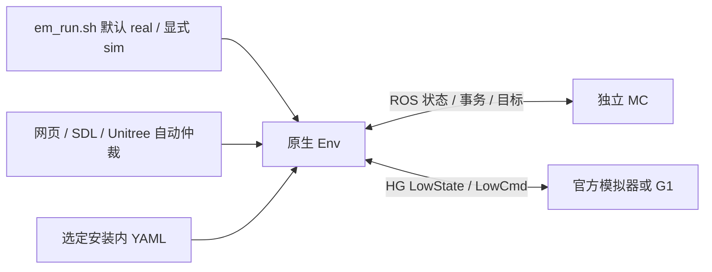

# anakin_env

Anakin 的原生 C++ 执行控制模块，作为独立的 ROS 2 Humble 包构建。它通过 `anakin_sdk` 定义的接口与 `anakin_mc` 交换状态、控制目标和推理状态。

## 构建

先安装 [anakin_sdk.revision](anakin_sdk.revision) 中锁定的 SDK 版本，再指定其安装前缀进行构建：

```sh
ANAKIN_SDK_PREFIX=/path/to/sdk/install/anakin_sdk ./build.sh
```

使用原生 CMake，构建需要 ROS 2 Humble、Unitree SDK2、yaml-cpp、SDL2、X11；无需 colcon workspace。SDK 默认来自相邻 `../anakin_sdk/install/anakin_sdk`，并检查版本锁。产物只进入本仓 `build/anakin_env/`、`install/anakin_env/`、`log/`。`./build.sh --test` 会运行现有离线测试；`--jobs N` 指定并行数。

## 运行

```sh
./em_run.sh                         # 默认 real：只启动原生 Env
./em_run.sh --real --input remote   # 实机；先配置明确的机器人网卡
./em_run.sh --sim --input auto  # 显式仿真；MC、官方模拟器分别启动
./em_run.sh --sim --real-checks # 回环仿真使用 real 状态机与守卫
```

完整操作步骤、端点、配置覆盖、网页控制、状态/输出表和用户验收边界见[独立运行说明](docs/standalone-operation.md)。旧 `--loopback-sim` 已移除并明确拒绝。正常入口不启动 MC、模拟器或测试夹具，不自动 reset；MC/Env 持续等待所需的新数据。

启动脚本使用本仓库的独立安装目录。可通过 `ANAKIN_PREFIX` 指定安装目录，通过 `ANAKIN_SDK_PREFIX` 指定 SDK。启动前检查选定 ELF、本地包标记、安装 YAML 和 SDK 构建记录；配置与该 ELF 的前缀一致。ROS 默认 domain 87，仅在本机发现节点；仿真 SDK 为 `lo` / domain 31，实机使用配置中的显式网卡 / domain 0。脚本直接运行 C++ 二进制文件；ROS 日志默认进入本仓 `log/ros/`。

`--sim --real-checks` 从安装的 `real.yaml` 加载实机状态机、守卫和时序，同时保留 `sim.yaml` 的回环传输；可用 `--real-config PATH` 指定另一份 real 规则。权限获取使用实机的异步流程和仿真服务替身，不访问机器人权限服务，因而不能验证真实硬件权限 RPC。

[AnakinC](https://github.com/zdYukino/AnakinC) 负责固定三个子仓版本及一键初始化、构建和 ENV + MC 联合启动。父仓入口默认 sim；本仓入口仍默认 real。可用 `ROS_PREFIX`、`UNITREE_SDK2_PREFIX` 指定依赖安装前缀。

## 架构

Env 使用一个 YAML 状态引擎、共用输入映射和共同 SDK PD 编码路径；sim/real 通过配置与后端选择区别路由、守卫和权限。MC 独立计算原模型/过渡的最终参考，Env 在当前事务、目标新鲜度、输出和权限检查后写入 SDK。SDK 发布成功不代表执行器已执行命令。



代码依据：[入口](em_run.sh)、[配置/状态机](src/state_machine.cpp)、[生产控制器](src/runtime.cpp)、[原生节点](src/native_node.cpp)、[传输](src/transport.cpp)、[异步实机权限](src/authority.cpp)、[安装规则](CMakeLists.txt)。显式无 SDK 的 ROS 夹具保留在 [integration_run.sh](scripts/integration_run.sh) 的测试路由中。

[原生检查点](docs/native-checkpoint.md)与[后续审查记录](docs/review-fixes-20261027.md)保留历史证据。当前软件检查不代替用户实际仿真或硬件验收，尚未声称策略稳定性、物理停止或设备接管已通过硬件测试。
